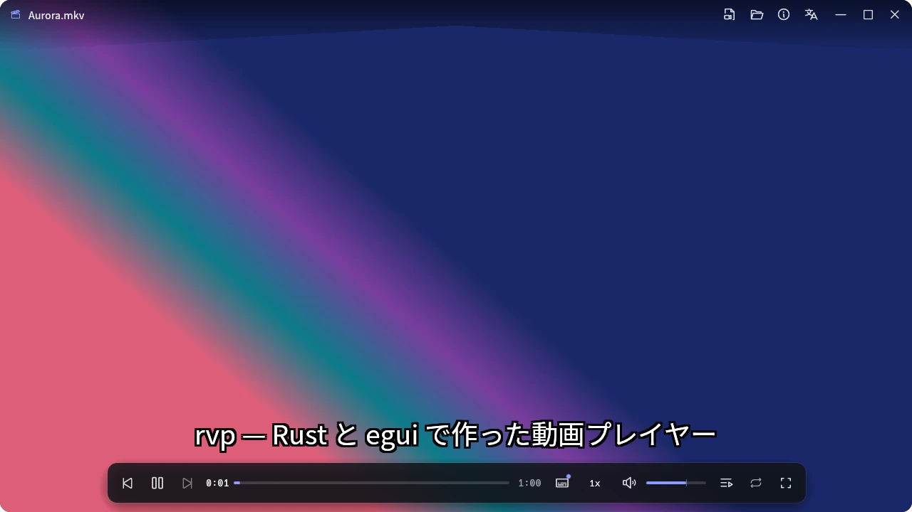
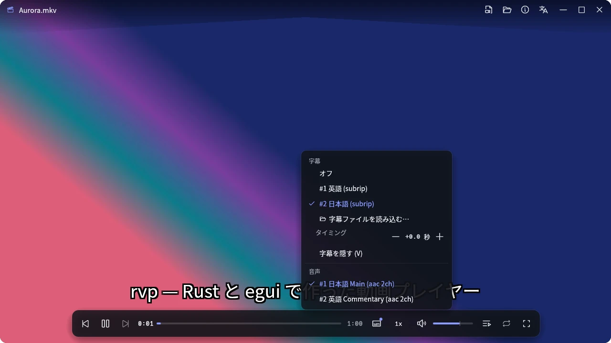
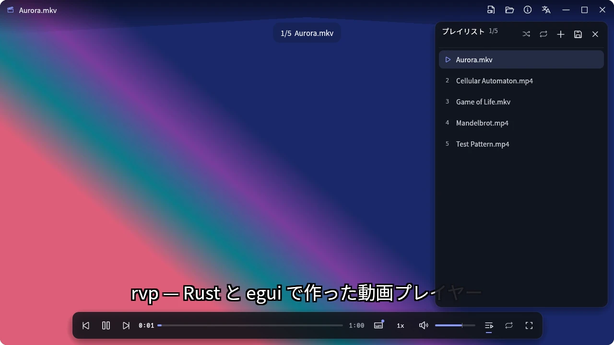
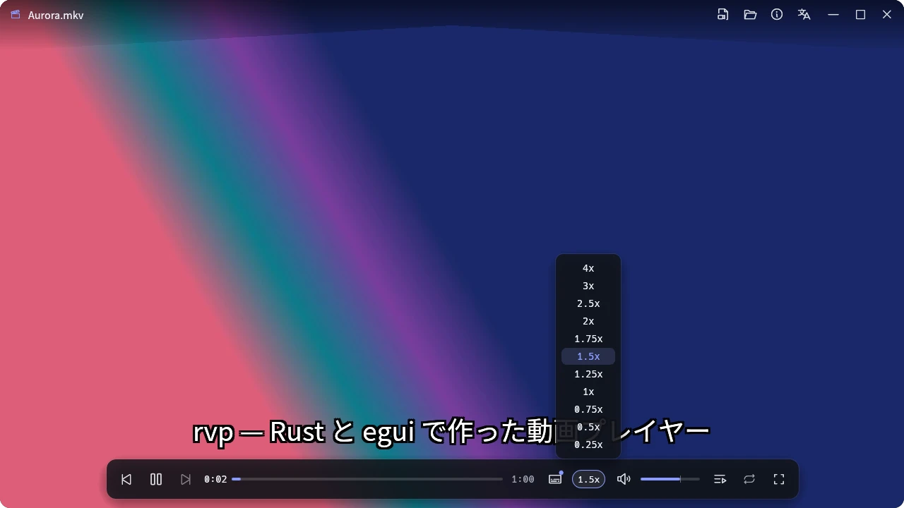
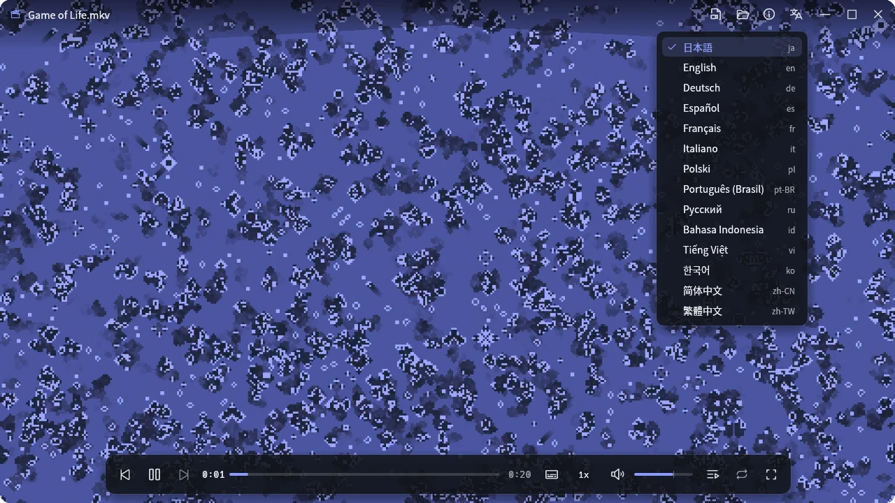
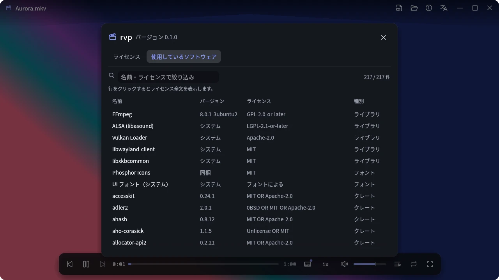
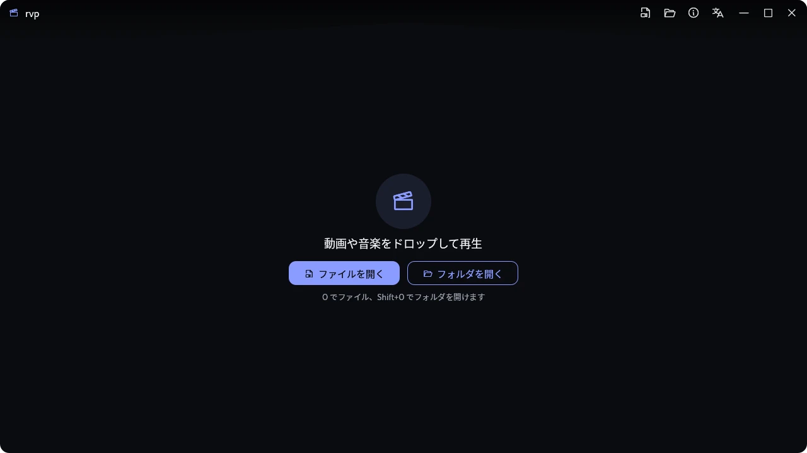

# rvp

[English](README.md) | **日本語**

Rust と [egui](https://github.com/emilk/egui) で作った、Linux 向けの動画プレイヤーです。



## 機能

### 枠なしのシンプルなプレイヤー

- 枠なしで角丸のダークテーマのウィンドウ。マウスを動かさないでいると、タイトルバーとコントロールが自動で隠れる
- FFmpeg でデコードし、YUV から RGB への変換は GPU（wgpu のシェーダ）で行う。BT.601 / 709 / 2020、8bit・10bit に対応
- ハードウェアデコード（CUDA / VAAPI）。使えない場合はソフトウェアに自動で切り替える
- 音声を基準にした同期、音量 0〜150%、前回の位置からの再開
- ファイルやフォルダをウィンドウにドロップして再生（Wayland / X11 の両方に対応）

### 字幕とトラック

メニューまたは `S` / `A` キーで、字幕トラックと音声トラックを切り替えられます。SRT / ASS / WebVTT の埋め込み字幕と外部ファイルに対応し、
Shift_JIS も自動で判別します。字幕のタイミングは 0.1 秒単位でずらせます。



### プレイリスト

フォルダを開くと中の動画をすべて再生します。リピート（1 本 / 全体）、シャッフル、ドラッグでの並べ替え、M3U8 での保存ができます。



### 再生速度

0.25〜4 倍。音の高さを保ったまま速度を変えます。



### 14 言語に対応

UI の言語は、初回起動時に OS の言語設定から選ばれ、タイトルバーからいつでも切り替えられます。
英語、日本語、ドイツ語、スペイン語、フランス語、イタリア語、ポーランド語、ポルトガル語（ブラジル）、ロシア語、インドネシア語、ベトナム語、
韓国語、中国語（簡体字・繁体字）。翻訳の追加や修正は [翻訳](#翻訳) を参照してください。



### ライセンス情報

「rvp について」（タイトルバーの ⓘ、または F1）で、rvp のライセンスと、使用しているソフトウェアすべてのライセンス全文を確認できます。



## 必要なもの

- Rust（stable、edition 2024）
- FFmpeg 8 の開発ライブラリ（`libavcodec-dev`、`libavformat-dev`、`libavfilter-dev`、`libswscale-dev`、`libswresample-dev`）
- ALSA の開発ライブラリ（`libasound2-dev`）。PipeWire や PulseAudio の環境でも ALSA 経由で音が出る
- 表示用のフォントは fontconfig で言語ごとに選ぶ。日本語・中国語・韓国語には CJK フォント（例：Noto Sans CJK）が必要

## 使い方

```bash
cargo run --release -- 動画.mkv [動画2.mp4 ...]
```

ファイルを開くとそのファイルだけ、フォルダを開くと中の動画をすべて再生します。字幕ファイルをウィンドウにドロップすると、
再生中の動画の字幕として読み込みます。



### Flatpak

[`flatpak/`](flatpak) に Flatpak のマニフェストがあります。FFmpeg は freedesktop ランタイムのものを使うので、FFmpeg の開発用パッケージは要りません。
サンドボックスの中でもハードウェアデコード（CUDA / VAAPI）が動きます。

```bash
flatpak remote-add --user --if-not-exists flathub https://dl.flathub.org/repo/flathub.flatpakrepo
flatpak-builder --user --install --force-clean --install-deps-from=flathub \
    flatpak/build-dir flatpak/io.github.TomoyukiNakama.rvp.yml
flatpak run io.github.TomoyukiNakama.rvp 動画.mkv
```

Flatpak 版の設定ファイルは `~/.var/app/io.github.TomoyukiNakama.rvp/config/rvp/` にあります。サンドボックスからはすべてのファイルを読めますが
（フォルダの再生と字幕の自動検出のため）、書き込みはファイル選択ダイアログ経由に限られます。

## キー操作

| キー | 動作 |
|---|---|
| Space | 再生 / 一時停止 |
| ← / →、Shift + ← / → | 5 秒 / 60 秒シーク |
| ↑ / ↓、ホイール | 音量 |
| M | ミュート |
| `[` / `]`、Backspace | 再生速度を下げる / 上げる、等速に戻す |
| N / B | 次 / 前の項目 |
| L | ループ（オフ → この動画 → プレイリスト全体） |
| P | プレイリスト |
| V / S / A | 字幕の表示切り替え / 字幕トラック / 音声トラック |
| Z / X | 字幕を 0.1 秒早める / 遅らせる |
| F、ダブルクリック、Esc | フルスクリーン / 解除 |
| F1 | rvp について（ライセンスと使用しているソフトウェア） |
| O / Shift+O | ファイルを開く / フォルダを開く |
| Ctrl+S | プレイリストを保存 |
| I | メディア情報 |
| Ctrl+H | ハードウェアデコードの切り替え |
| Q | 終了 |

## 設定

`~/.config/rvp/config.toml`（アプリが自動で書き込みます。手で編集してもかまいません。書かれていない項目は既定値になります）

```toml
volume = 1.0              # 0.0〜1.5
muted = false
repeat = "off"            # off / all / one
shuffle = false
queue_siblings = false    # true: ファイルを開くと同じフォルダの動画も続けて再生
resume = true
seek_small = 5.0
seek_large = 60.0
hwdec = "auto"            # auto / off / cuda / vaapi
language = "ja"           # UI の言語。初回起動時に OS の設定から決める
```

再生位置は `~/.local/state/rvp/resume.toml` に保存されます。

## 翻訳

UI の文字列は [`locales/`](locales) にある [Project Fluent](https://projectfluent.org/) 形式のファイルにまとめています（基準は `en.ftl`）。
ビルドし直さずに翻訳を直したり追加したりするには、`~/.config/rvp/locales/` に `<言語タグ>.ftl` を置きます。
同梱の文字列を上書きするか（一部だけでも可）、新しい言語としてメニューに追加されます（表示名は `language-name = …`）。
これらのファイルは実行中も自動で読み直します。

`locales/*.ftl` へのプルリクエストを歓迎します。どのファイルも `en.ftl` と同じメッセージと変数を持つことを `cargo test` で検査します。
複雑な文字の組み立てや右から左への表示が必要な文字（タイ語、インド系の文字、アラビア語など）は、egui がまだ対応していません。

## 開発

```bash
cargo test                       # 単体テストと統合テスト（ffmpeg CLI でテスト動画を作る）
scripts/gen-test-media.sh        # 手動確認用のテスト動画を target/test-media/ に作る
scripts/gen-readme-shots.sh      # README のスクリーンショットを docs/images/ に作り直す
```

依存クレートを変えたら、ライセンス一覧（`licenses/third-party.toml`）を作り直してください。

```bash
python3 scripts/gen-licenses.py           # 再生成
python3 scripts/gen-licenses.py --check   # 最新かどうかの確認
python3 flatpak/gen-cargo-sources.py      # Flatpak のオフラインビルド用のクレート一覧
```

仕様は `SPEC.md`、開発メモは `CLAUDE.md` を参照してください。

## ライセンス

Copyright (C) 2026 Tomoyuki Nakama

rvp は [GNU General Public License v3.0](LICENSE)（またはそれ以降のバージョン）で配布します。
システムの FFmpeg（GPL ビルド）を動的リンクするため GPL にしています。

使用しているソフトウェアとそのライセンスの一覧は、アプリの「rvp について」で確認できます。
クレートのライセンス本文は `licenses/third-party.toml` にあります。
