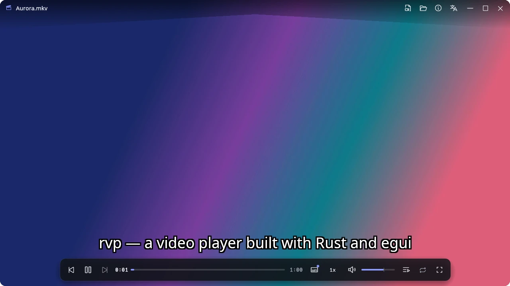
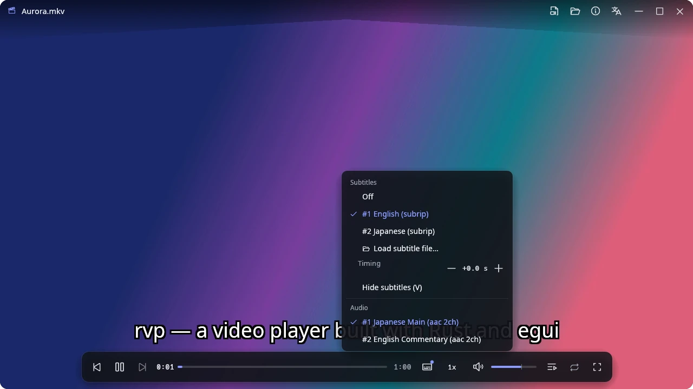
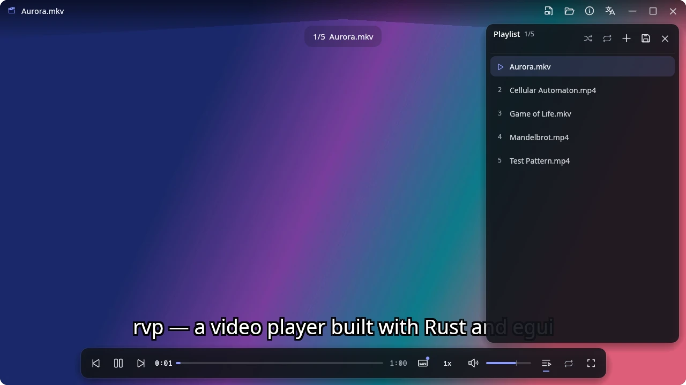
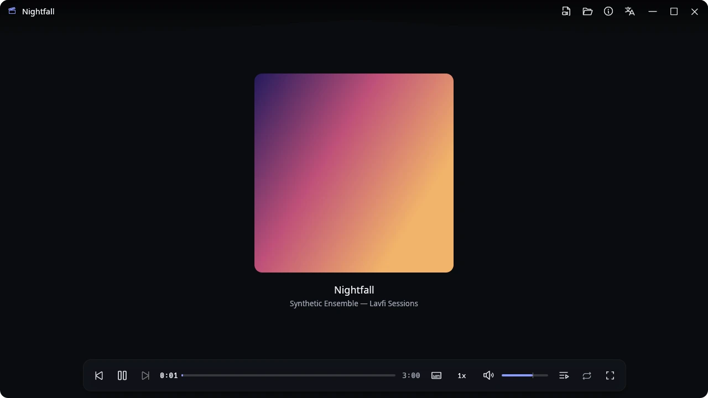
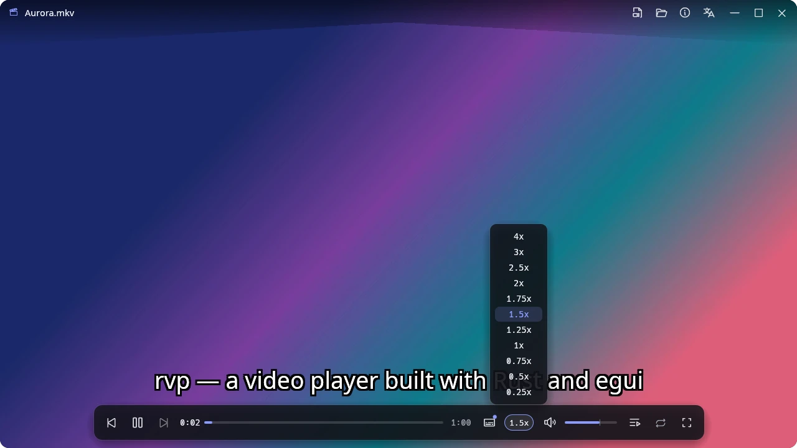
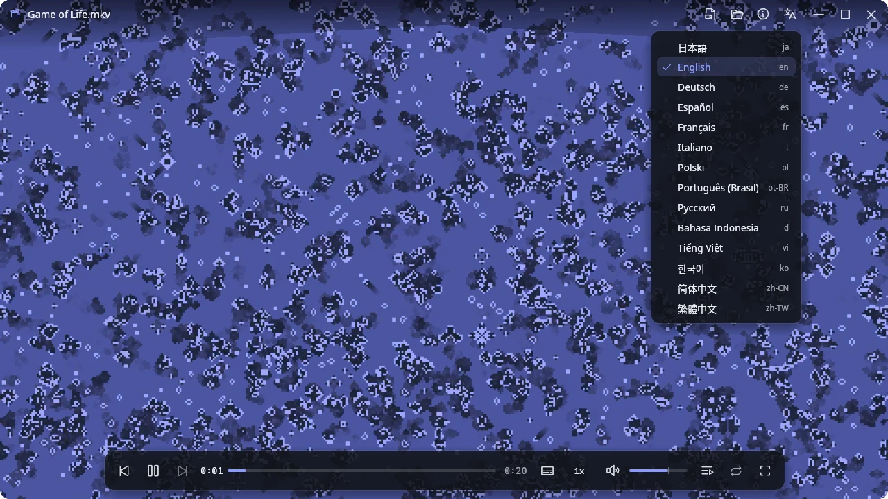
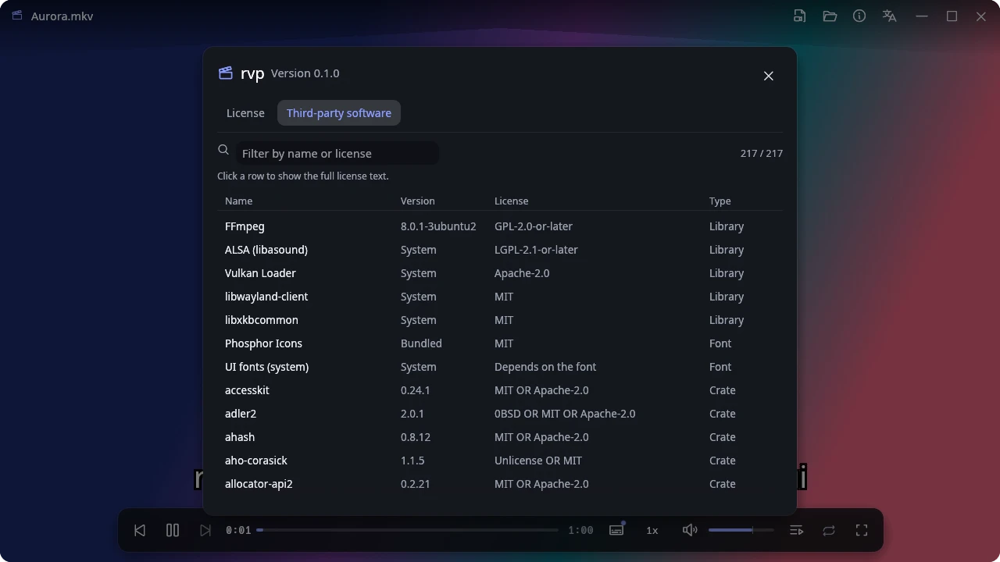
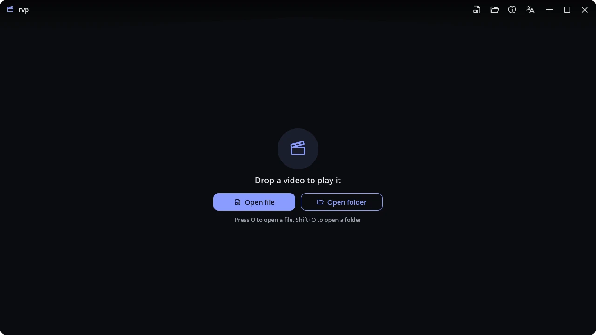

# rvp

**English** | [日本語](README.ja.md)

A video and music player for Linux, built with Rust and [egui](https://github.com/emilk/egui).



## Features

### Clean, borderless player

- Borderless, rounded dark window. The title bar and controls fade out when you stop moving the mouse
- Decoding with FFmpeg; Y'CbCr → RGB conversion on the GPU (wgpu shader). BT.601 / 709 / 2020, 8- and 10-bit
- Hardware decoding (CUDA / VAAPI), with automatic fallback to software decoding
- Audio-clocked A/V sync, volume 0–150 %, resume from where you left off
- Drop files or folders onto the window to play them (Wayland and X11)

### Subtitles and tracks

Switch subtitle and audio tracks from the menu or with `S` / `A`. SRT / ASS / WebVTT, both embedded and external files
(Shift_JIS is detected too). Subtitle timing can be shifted in 0.1 s steps.



### Playlist

Open a folder to play all of its videos. Repeat (one / all), shuffle, drag to reorder, and save as M3U8.



### Music and other audio files

Audio-only files (MP3, FLAC, Ogg/Opus, M4A, WAV…) play too, showing the embedded cover art with the title, artist and
album. Folders and playlists may mix videos and music.



### Playback speed

0.25× – 4× with pitch-preserving audio.



### 14 languages

The UI language follows your OS locale on first start and can be changed at any time from the title bar —
English, Japanese, German, Spanish, French, Italian, Polish, Portuguese (Brazil), Russian, Indonesian, Vietnamese,
Korean and Chinese (Simplified / Traditional). See [Translations](#translations) to add or improve one.



### Licence information

**About rvp** (ⓘ in the title bar, or F1) shows rvp's licence and every third-party component with its full licence text.



## Requirements

- Rust (stable, edition 2024)
- FFmpeg 8 development libraries (`libavcodec-dev`, `libavformat-dev`, `libavfilter-dev`, `libswscale-dev`, `libswresample-dev`)
- ALSA development library (`libasound2-dev`). Sound also works on PipeWire / PulseAudio through ALSA
- Fonts are chosen per language with fontconfig. Japanese, Chinese and Korean need a CJK font (e.g. Noto Sans CJK)

## Usage

```bash
cargo run --release -- video.mkv [song.flac ...]
```

Opening a file plays just that file; opening a folder plays every video and audio file in it. Dropping a subtitle file onto the
window loads it for the current video.



### Flatpak

A Flatpak manifest is in [`flatpak/`](flatpak). It uses FFmpeg from the freedesktop runtime, so no FFmpeg development
packages are needed; hardware decoding (CUDA / VAAPI) works inside the sandbox.

```bash
flatpak remote-add --user --if-not-exists flathub https://dl.flathub.org/repo/flathub.flatpakrepo
flatpak-builder --user --install --force-clean --install-deps-from=flathub \
    flatpak/build-dir flatpak/io.github.TomoyukiNakama.rvp.yml
flatpak run io.github.TomoyukiNakama.rvp video.mkv
```

Inside Flatpak the settings live in `~/.var/app/io.github.TomoyukiNakama.rvp/config/rvp/`. The sandbox can read
all files (needed for folders and automatic subtitle detection) but writes only through the file chooser.

## Keyboard shortcuts

| Key | Action |
|---|---|
| Space | Play / pause |
| ← / →, Shift + ← / → | Seek 5 s / 60 s |
| ↑ / ↓, mouse wheel | Volume |
| M | Mute |
| `[` / `]`, Backspace | Slower / faster, reset to 1× |
| N / B | Next / previous item |
| L | Loop (off → this item → whole playlist) |
| P | Playlist |
| V / S / A | Show/hide subtitles / next subtitle track / next audio track |
| Z / X | Subtitles 0.1 s earlier / later |
| F, double-click, Esc | Full screen / exit full screen |
| F1 | About rvp (licences and third-party software) |
| O / Shift+O | Open file / open folder |
| Ctrl+S | Save playlist |
| I | Media info |
| Ctrl+H | Toggle hardware decoding |
| Q | Quit |

## Configuration

`~/.config/rvp/config.toml` — written by the app; you can also edit it by hand (missing keys use the defaults).

```toml
volume = 1.0              # 0.0–1.5
muted = false
repeat = "off"            # off / all / one
shuffle = false
queue_siblings = false    # true: opening a file also queues the other media files in its folder
resume = true
seek_small = 5.0
seek_large = 60.0
hwdec = "auto"            # auto / off / cuda / vaapi
language = "en"           # UI language; detected from the OS locale on first start
```

Playback positions are stored in `~/.local/state/rvp/resume.toml`.

## Translations

UI strings live in [Project Fluent](https://projectfluent.org/) files under [`locales/`](locales) (`en.ftl` is the
reference). To fix or add a translation without rebuilding, put a `<language tag>.ftl` file into
`~/.config/rvp/locales/` — it overrides the built-in messages (a partial file is fine) or adds a new language to the
menu (name it with `language-name = …`). rvp reloads these files while it is running.

Pull requests for `locales/*.ftl` are welcome; `cargo test` checks that every file has the same messages and
variables as `en.ftl`. Scripts that need complex text shaping or right-to-left layout (Thai, Indic scripts, Arabic…)
are not supported by egui yet.

## Development

```bash
cargo test                       # unit and integration tests (the ffmpeg CLI generates a test clip)
scripts/gen-test-media.sh        # test clips for manual checks → target/test-media/
scripts/gen-readme-shots.sh      # regenerate the README screenshots → docs/images/
```

After changing dependencies, regenerate the licence list (`licenses/third-party.toml`):

```bash
python3 scripts/gen-licenses.py           # regenerate
python3 scripts/gen-licenses.py --check   # verify it is up to date
python3 flatpak/gen-cargo-sources.py      # crate list for the offline Flatpak build
```

The specification is in `SPEC.md` and development notes are in `CLAUDE.md` (both partly in Japanese).

## Licence

Copyright (C) 2026 Tomoyuki Nakama

rvp is distributed under the [GNU General Public License v3.0](LICENSE) or (at your option) any later version.
It is GPL because it dynamically links the system FFmpeg (a GPL build).

The third-party software rvp uses and its licences are listed in the app's **About rvp** dialog;
the crate licence texts are in `licenses/third-party.toml`.
